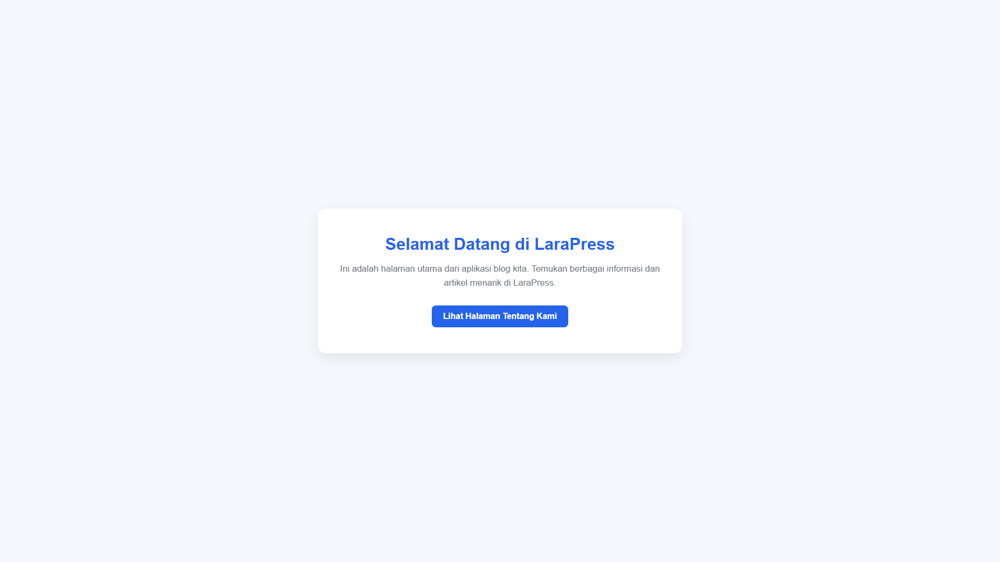
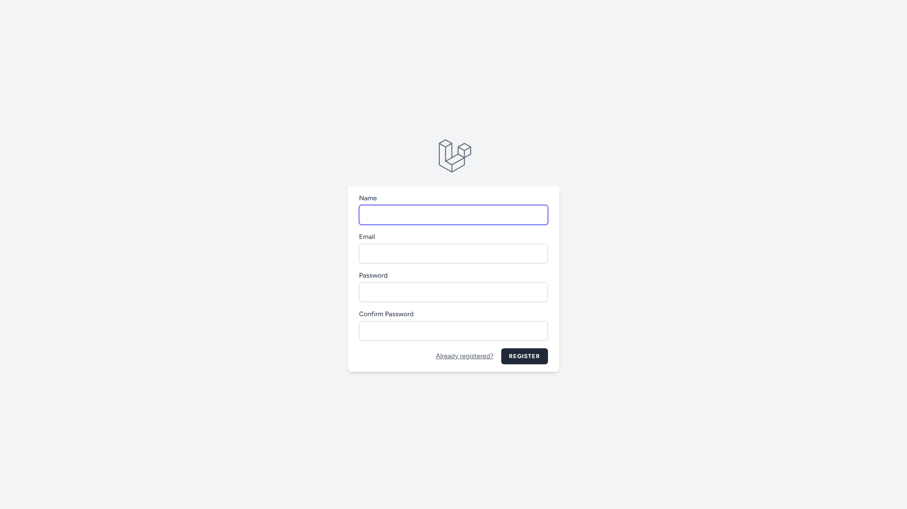
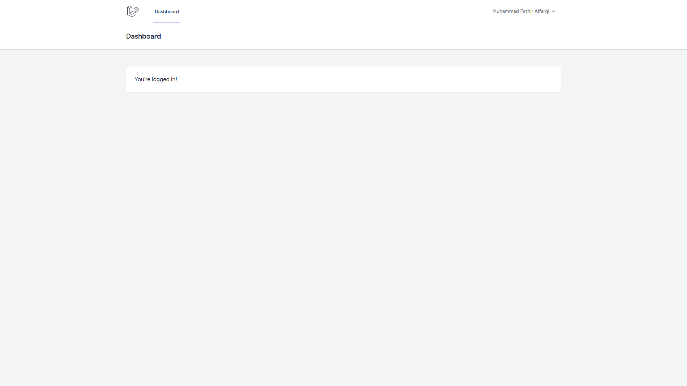
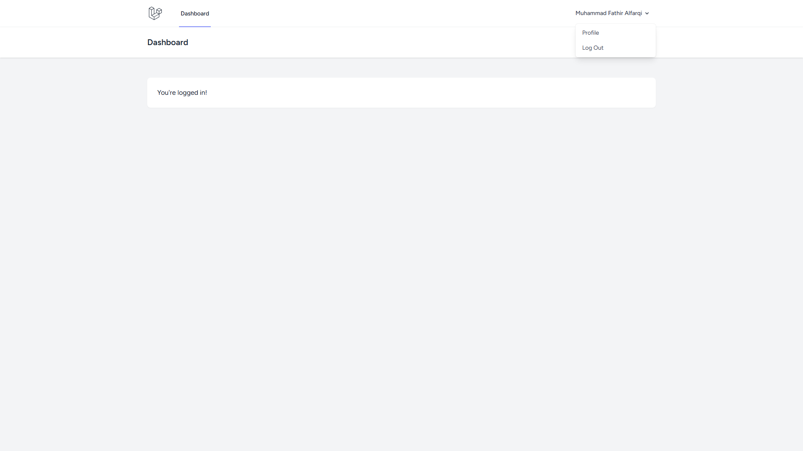
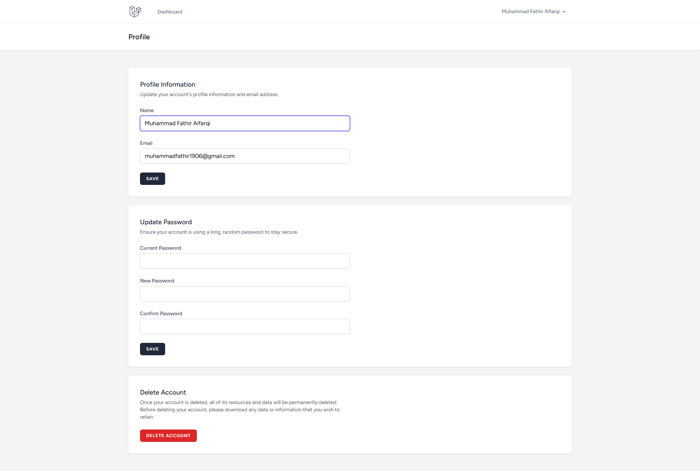

# 📘 Laporan Praktikum Pertemuan Ke - 4

🧑‍🎓 Muhammad Fathir Alfarqi - 4524210064

# 🔐 Autentikasi Login dengan Laravel Breeze & Pengamanan Rute CRUD

---

## 📌 Ringkasan Materi

Pada praktikum Pertemuan 4 ini, kita mengimplementasikan sistem autentikasi lengkap ke dalam aplikasi web **LaraPress** menggunakan **Laravel Breeze**. Autentikasi adalah pilar fundamental keamanan aplikasi web yang bertugas memverifikasi identitas pengguna (*"Siapa Anda?"*), berbeda dengan otorisasi yang menentukan hak akses (*"Apa yang boleh Anda lakukan?"*).

---

## 🧠 Bagian 1: Konsep & Filosofi Autentikasi

### 1. Filosofi Autentikasi vs Otorisasi
- **Autentikasi (Authentication)**: Proses verifikasi keabsahan identitas pengguna.
  - *Analogi*: Menunjukkan Kartu Tanda Mahasiswa (KTM) kepada satpam di gerbang masuk kampus.
- **Otorisasi (Authorization)**: Penentuan hak akses setelah identitas terbukti.
  - *Analogi*: Kartu mahasiswa Anda hanya mengizinkan Anda masuk ke lab fakultas teknik, bukan fakultas kedokteran.

### 2. Alur Kerja Login Sederhana
1. **Pengiriman Kredensial**: Pengguna memasukkan email dan password melalui form login.
2. **Pencarian Data**: Sistem mencari data pengguna di database berdasarkan email.
3. **Verifikasi Hash Password**: Password yang diketik di-hash dan dicocokkan dengan hash yang ada di database (bukan perbandingan teks polos).
4. **Keberhasilan Autentikasi**: Jika hash cocok, sesi (*session*) pengguna dibuat di server dan ID sesi dikirim ke browser via *cookie*.
5. **Manajemen Sesi**: Pada setiap permintaan berikutnya, browser mengirimkan cookie tersebut sehingga server mengenali pengguna yang telah masuk (*analogi: stempel konser*).

### 3. Keamanan Tambahan
- **Password Hashing (Bcrypt/Argon2)**: Pengacakan satu arah yang aman dari kebocoran database.
- **CSRF Protection (`@csrf`)**: Melindungi form dari serangan Cross-Site Request Forgery.

---

## 🛠️ Bagian 2: Langkah-Langkah Praktikum

1. **Instalasi Breeze via Composer**
   ```bash
   composer require laravel/breeze --dev
   ```

2. **Scaffolding Breeze (Blade & Alpine)**
   ```bash
   php artisan breeze:install blade --pest
   ```

3. **Instalasi Dependensi Frontend & Kompilasi Aset**
   ```bash
   npm install
   npm run build
   ```

4. **Menjalankan Migrasi Database**
   ```bash
   php artisan migrate
   ```

---

## 🔍 Bagian 3: Membedah Hasil Instalasi

1. **Rute Autentikasi Baru**: Baris `require __DIR__.'/auth.php';` ditambahkan ke `routes/web.php` untuk memuat rute login, register, reset password, dan verifikasi email.
2. **Controller Autentikasi**: Terletak di direktori `app/Http/Controllers/Auth/` (misalnya `AuthenticatedSessionController.php`, `RegisteredUserController.php`).
3. **Tampilan (Views)**: Form blade baru tersedia di `resources/views/auth/` lengkap dengan Tailwind CSS.

---

## 🛡️ Bagian 4: Mengamankan Rute CRUD (Protected Routes)

Untuk memastikan fitur manajemen postingan hanya dapat diakses oleh pengguna yang sudah login, seluruh rute CRUD dibungkus dengan middleware `auth` pada `routes/web.php`:

```php
Route::middleware('auth')->group(function () {
    Route::get('/profile', [ProfileController::class, 'edit'])->name('profile.edit');
    Route::patch('/profile', [ProfileController::class, 'update'])->name('profile.update');
    Route::delete('/profile', [ProfileController::class, 'destroy'])->name('profile.destroy');

    // Mengamankan Rute CRUD Postingan
    Route::get('/posts/create', [PostController::class, 'create'])->name('posts.create');
    Route::post('/posts', [PostController::class, 'store'])->name('posts.store');
    Route::get('/posts/{post}/edit', [PostController::class, 'edit'])->name('posts.edit');
    Route::put('/posts/{post}', [PostController::class, 'update'])->name('posts.update');
    Route::delete('/posts/{post}', [PostController::class, 'destroy'])->name('posts.destroy');
});
```

### Hasil Pengujian Proteksi:
Ketika pengguna dalam kondisi **logout** mencoba mengakses URL `http://127.0.0.1:8098/posts/create`, Laravel secara otomatis mengarahkan (*redirect*) permintaan ke halaman `http://127.0.0.1:8098/login`.

---

## 📸 Hasil Screenshot Tampilan Aplikasi & Pengujian

### 1. Halaman Welcome LaraPress (Navigasi Log In & Register)


---

### 2. Halaman Registrasi Akun Baru


---

### 3. Halaman Login


---

### 4. Halaman Dashboard (Setelah Login)


---

### 5. Menu Dropdown Profil Akun


---

### 6. Halaman Edit Profil


---

### 7. Uji Coba Rute Terproteksi (`/posts/create` -> Otomatis Redirect ke `/login`)


---

## 🎯 Kesimpulan

Melalui praktikum Pertemuan 4 ini, sistem autentikasi lengkap menggunakan Laravel Breeze berhasil diintegrasikan ke proyek LaraPress. Rute-rute penting untuk pengelolaan postingan telah diamankan menggunakan middleware `auth`, menjamin bahwa hanya pengguna yang telah terautentikasi yang dapat melakukan operasi CRUD.

<p align="center">
Made with ❤️ for Praktikum Pemrograman Berbasis Web (PBW) A
</p>
