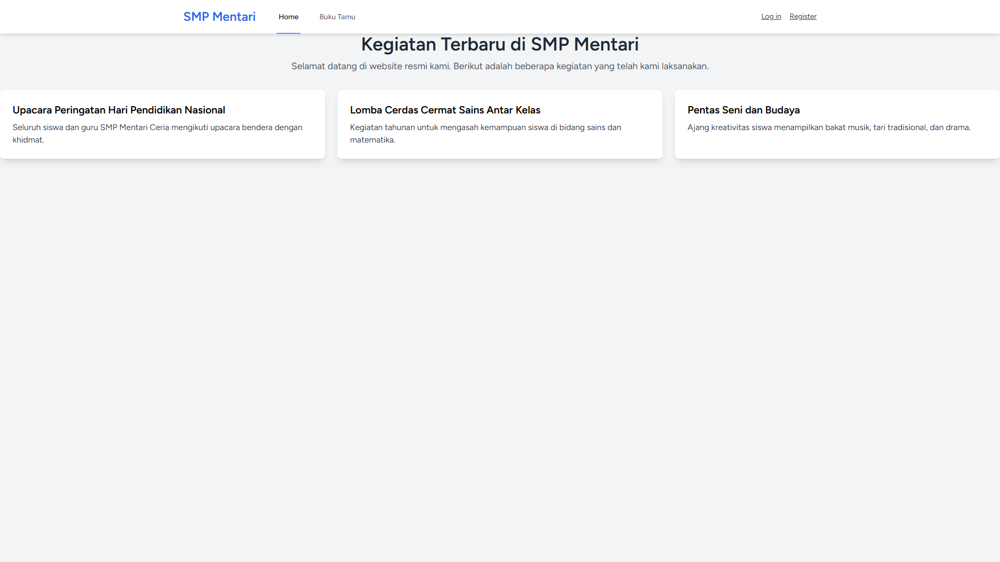
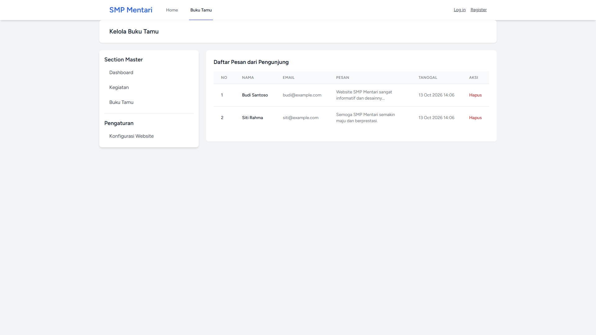
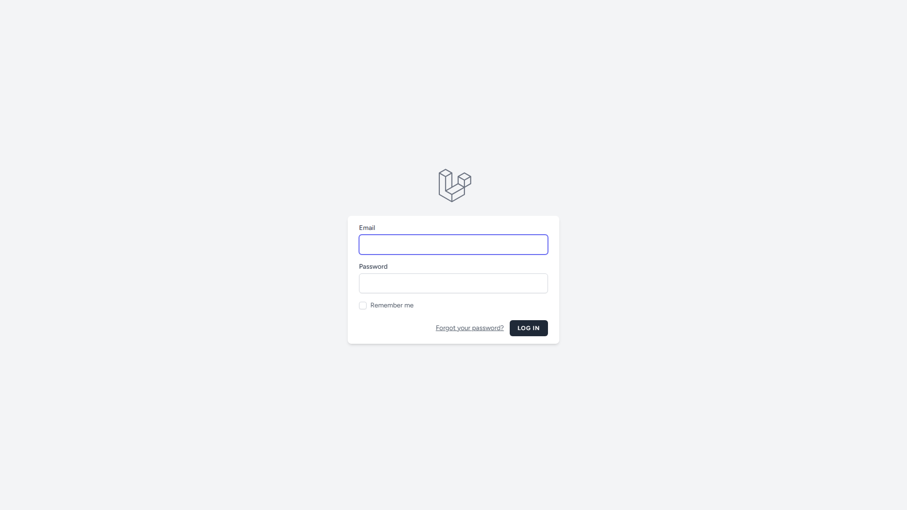
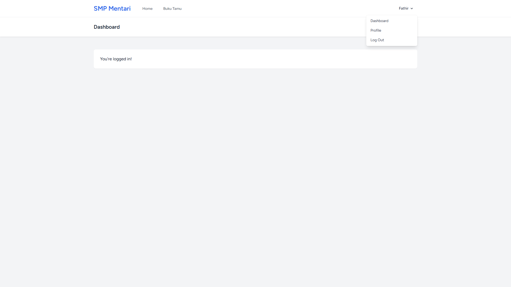
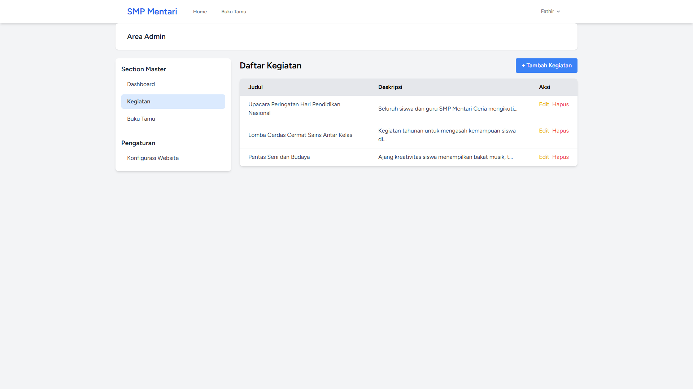
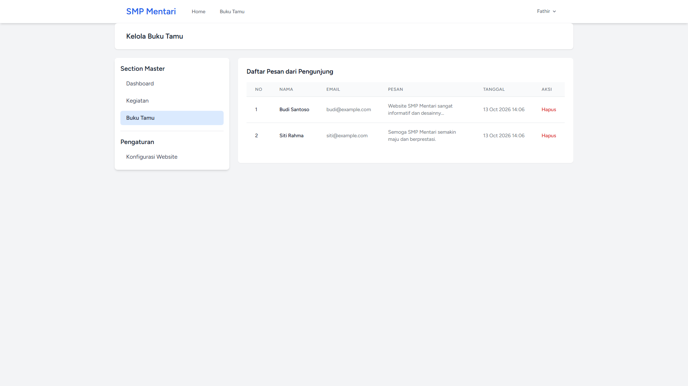
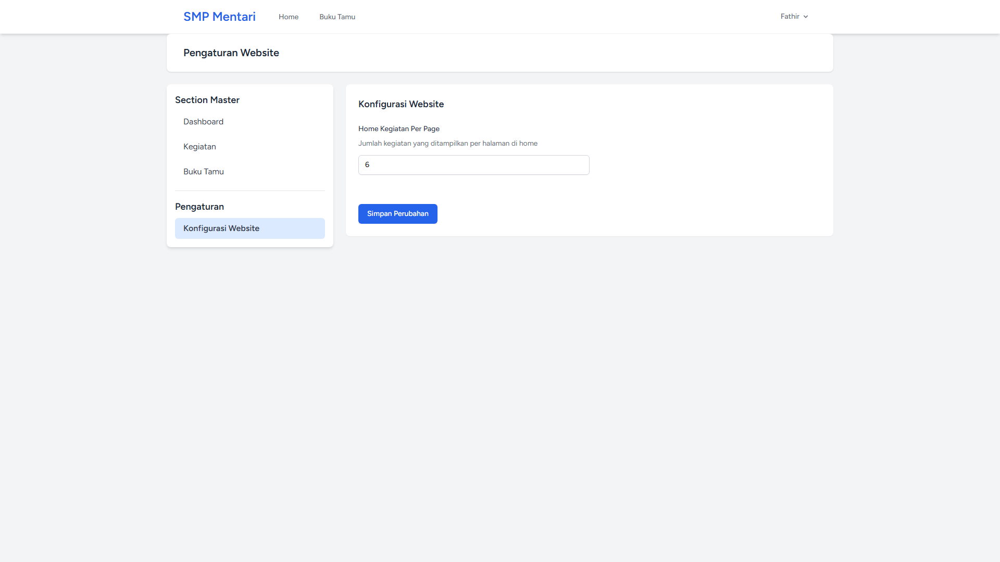

# 📘 Laporan Praktikum Pertemuan Ke - 5

🧑‍🎓 Muhammad Fathir Alfarqi - 4524210064

# 🏫 Website SMP Mentari Ceria

Aplikasi website sekolah berbasis Laravel yang menampilkan informasi kegiatan sekolah dan fitur buku tamu digital untuk SMP Mentari Ceria.

<p align="center">
  
  
  
</p>

## Instalasi

### 1. Clone Repository

```bash
git clone https://github.com/adiwp/pbw.git
cd smpmentari
```

### 2. Install Dependencies

```bash
# Install PHP dependencies
composer install

# Install Node dependencies
npm install
```

### 3. Setup Environment

```bash
# Copy file .env
cp .env.example .env

# Generate application key
php artisan key:generate
```

### 4. Setup Database

```bash
# Jalankan migrasi
php artisan migrate
```

### 5. Build Assets

```bash
# Development
npm run dev

# Production
npm run build
```

### 6. Jalankan Aplikasi

```bash
# Menggunakan built-in server
php artisan serve

# Atau menggunakan composer script (recommended)
composer dev
```

Aplikasi akan berjalan di: `http://localhost:8000`

## 📋 Daftar Isi

- [Tentang Aplikasi](#-tentang-aplikasi)
- [Fitur Utama](#-fitur-utama)
- [Tech Stack](#-tech-stack)
- [Persyaratan Sistem](#-persyaratan-sistem)
- [Instalasi](#-instalasi)
- [Penggunaan](#-penggunaan)
- [Struktur Database](#-struktur-database)
- [Struktur Project](#-struktur-project)
- [Pengembangan](#-pengembangan)
- [Testing](#-testing)
- [Lisensi](#-lisensi)

## 🎯 Tentang Aplikasi

Website SMP Mentari Ceria adalah aplikasi web sederhana yang dibangun dengan Laravel 12 untuk menampilkan informasi dan kegiatan sekolah. Aplikasi ini dilengkapi dengan fitur buku tamu digital yang memungkinkan pengunjung meninggalkan pesan dan kesan mereka.

### Fitur Halaman:

1. **Halaman Home** - Menampilkan kegiatan-kegiatan terbaru sekolah
2. **Buku Tamu** - Formulir interaktif untuk pengunjung meninggalkan pesan

## ✨ Fitur Utama

- ✅ **Tampilan Kegiatan Sekolah** - Showcase kegiatan terbaru dengan card design
- ✅ **Buku Tamu Digital** - Pengunjung dapat meninggalkan pesan
- ✅ **Form Validasi** - Validasi input untuk nama, email, dan pesan
- ✅ **Real-time Feedback** - Notifikasi sukses/error setelah submit
- ✅ **Responsive Design** - Tampilan optimal di semua device
- ✅ **Timestamp Relatif** - Menampilkan waktu pesan (e.g., "2 jam yang lalu")
- ✅ **Modern UI/UX** - Desain clean dengan Tailwind CSS

## 🛠️ Tech Stack

### Backend
- **Laravel** 12.x - PHP Framework
- **PHP** ^8.2 - Programming Language
- **SQLite** - Database (Development)
- **Eloquent ORM** - Database Management

### Frontend
- **Blade Templates** - Template Engine
- **Tailwind CSS** 4.0 - CSS Framework
- **Vite** 7.0 - Asset Bundler & HMR
- **Axios** - HTTP Client

### Development Tools
- **Laravel Sail** - Docker Development Environment
- **Pest PHP** - Testing Framework
- **Laravel Pint** - Code Style Fixer
- **Concurrently** - Multi-command Runner

## 📸 Hasil Screenshot Tampilan Website SMP Mentari

### Halaman Home


### Halaman Buku Tamu


### Halaman Register


### Halaman Login


### Halaman Dashboard

Dashboard di akses ketika sudah login dan bisa mengatur atau pusat kendali dari website SMP Mentari




Kendali atau mengelola kegiatan SMP Mentari



Kelola Buku Tamu



Konfigurasi tampilan Home Kegiatan per page dengan default nya 6 (Bisa diubah sesuai keinginan)



<p align="center">
Made with ❤️ for SMP Mentari Ceria
</p>
