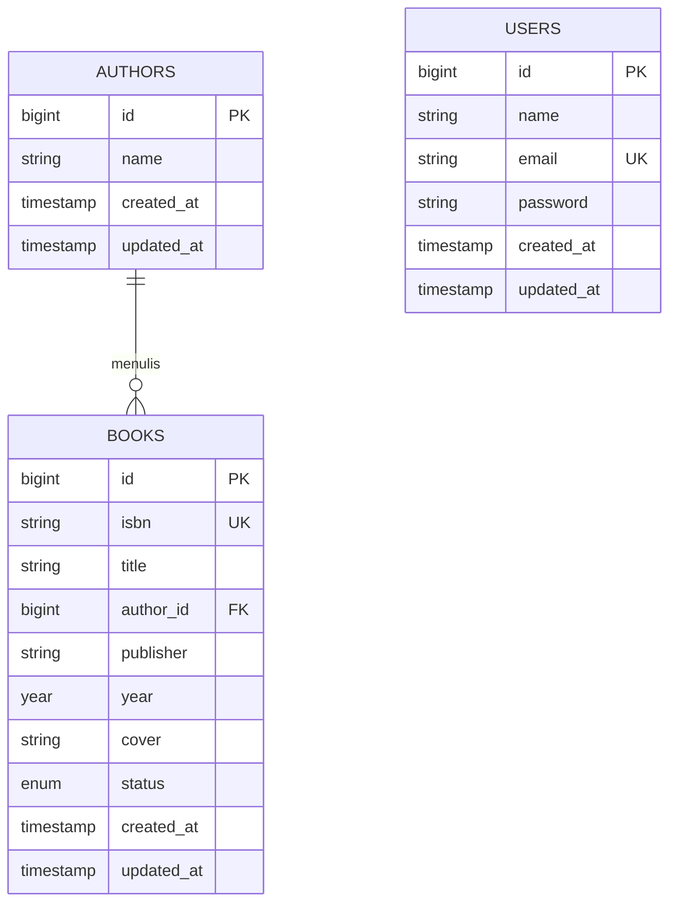

# 📘 Laporan Praktikum Pemrograman Berbasis Web - Pertemuan 6

🧑‍🎓 **Muhammad Fathir Alfarqi** — `4524210064`  
🏛️ **Program Studi**: Teknik Informatika  
📌 **Topik**: Membangun Admin Panel Sistem Manajemen Buku Menggunakan Laravel 12 & Filament 3.x  

---

# 📚 AuthBook — Book Management Admin Panel System

**AuthBook** merupakan aplikasi berbasis web untuk pengelolaan katalog buku dan data penulis (*author*) yang dirancang secara modern menggunakan framework **Laravel 12** dan admin panel **Filament 3.x**. Aplikasi ini mengimplementasikan konsep TALL Stack (Tailwind CSS, Alpine.js, Laravel, Livewire) untuk menghasilkan antarmuka manajemen data yang responsif, deklaratif, dan memiliki performa tinggi tanpa perlu menulis kode frontend secara manual.

<p align="center">
  
  
  
  
  
  
</p>

---

## ⚡ Panduan Cepat Menjalankan Aplikasi (*Quick Start*)

Ikuti langkah-langkah di bawah ini untuk mengkloning dan menjalankan proyek pada komputer lokal:

```bash
# 1. Beralih ke direktori proyek
cd "Pertemuan 6/authbook"

# 2. Unduh dependensi backend (Composer) & frontend (NPM)
composer install
npm install

# 3. Pengaturan environment aplikasi
cp .env.example .env
php artisan key:generate

# 4. Inisialisasi basis data SQLite dan generate data awal (seeding)
touch database/database.sqlite
php artisan migrate:fresh --seed

# 5. Konfigurasi symbolic link untuk berkas media publik
php artisan storage:link

# 6. Kompilasi aset dan aktifkan server lokal Laravel
npm run build
php artisan serve
```

Akses portal admin Filament melalui peramban web:  
🌐 **`http://localhost:8000/admin`**

**Akun Administrator Standar:**
* **Email Akun**: `admin@example.com`
* **Kata Sandi**: `password`

---

## 📑 Daftar Isi Laporan

- [Ringkasan & Karakteristik Aplikasi](#-ringkasan--karakteristik-aplikasi)
- [Konsep Arsitektur & Filosofi Filament 3.x](#-konsep-arsitektur--filosofi-filament-3x)
- [Kompetensi dan Sasaran Pembelajaran](#-kompetensi-dan-sasaran-pembelajaran)
- [Daftar Fitur Unggulan](#-daftar-fitur-unggulan)
- [Susunan Teknologi (Tech Stack)](#-susunan-teknologi-tech-stack)
- [Rancangan Basis Data & Relasi ERD](#-rancangan-basis-data--relasi-erd)
- [Dokumentasi Lengkap Tahapan Praktikum](#-dokumentasi-lengkap-tahapan-praktikum)
  - [Bagian 1: Inisialisasi Proyek Laravel & Integrasi Filament](#bagian-1-inisialisasi-proyek-laravel--integrasi-filament)
  - [Bagian 2: Konstruksi Model, Relasi Eloquent, dan Migrasi Skema](#bagian-2-konstruksi-model-relasi-eloquent-dan-migrasi-skema)
  - [Bagian 3: Implementasi Factory Generator dan Database Seeding](#bagian-3-implementasi-factory-generator-dan-database-seeding)
  - [Bagian 4: Pembuatan Filament Resources (Author & Book)](#bagian-4-pembuatan-filament-resources-author--book)
  - [Bagian 5: Otorisasi Keamanan Berbasis Kebijakan (Policies)](#bagian-5-otorisasi-keamanan-berbasis-kebijakan-policies)
  - [Bagian 6: Pembuatan Akun Administrator & Pengujian CRUD](#bagian-6-pembuatan-akun-administrator--pengujian-crud)
  - [Bagian 7: Validasi Rute, Basis Data, dan Optimalisasi Sistem](#bagian-7-validasi-rute-basis-data-dan-optimalisasi-sistem)
- [Dokumentasi Evaluasi Tugas 1: Implementasi Dasar](#-dokumentasi-evaluasi-tugas-1-implementasi-dasar)
- [Petunjuk Pemecahan Masalah (Troubleshooting)](#-petunjuk-pemecahan-masalah-troubleshooting)

---

## 📌 Ringkasan & Karakteristik Aplikasi

Aplikasi **AuthBook** dibangun untuk menjawab kebutuhan back-office perpustakaan atau katalog publikasi secara efisien. Dengan memanfaatkan kapabilitas deklaratif Filament, aplikasi menyediakan antarmuka pengolahan data buku dan penulis secara menyeluruh (CRUD).

### Keunggulan Sistem:
1. **Pendekatan Deklaratif**: Struktur form dan tabel disusun murni menggunakan PHP tanpa perlu merancang HTML/CSS satu per satu.
2. **Relasi Dinamis & Interaktif**: Memungkinkan pemilihan author secara instan dengan pencarian cepat (*preload & searchable*), serta form penambahan penulis baru langsung dari pop-up (*inline modal*).
3. **Manajemen Media Aman**: Penyimpanan cover buku tersimpan terstruktur dalam direktori publik storage dengan validasi tipe berkas dan batas kapasitas.
4. **Proteksi Hak Akses**: Setiap interaksi resource dipantau oleh Laravel Policies untuk memastikan integritas data.

---

## 💡 Konsep Arsitektur & Filosofi Filament 3.x

Filament mengusung paradigma:
> *"Make the common things easy, and the hard things possible"*

Prinsip-prinsip desain utama Filament yang diterapkan dalam praktikum ini mencakup:
* **Rapid Application Development (RAD)**: Memangkas waktu pembuatan admin panel dari hari/minggu menjadi hitungan menit.
* **Declarative Schema**: Cukup deklarasikan komponen yang diinginkan (misal `TextInput::make()`, `Select::make()`), dan Filament akan menangani validasi, rendering, responsivitas, dan interaksi database.
* **Full-Stack Ecosystem**: Menggabungkan kemampuan Forms, Tables, Actions, Infolists, Modals, dan Widgets dalam satu kesatuan arsitektur yang solid.
* **Convention over Configuration**: Mengikuti kaidah standar Laravel sehingga meminimalkan konfigurasi rumit dan menjaga kerapian struktur kode sumber.
* **Developer Experience (DX)**: Menyediakan dukungan *type hinting* yang lengkap, autocompletion di IDE, serta pesan error yang jelas.

---

## 🎯 Kompetensi dan Sasaran Pembelajaran

Melalui pengerjaan praktikum pertemuan 6 ini, kompetensi yang dicapai meliputi:
* [x] Memahami konsep arsitektur MVC (*Model-View-Controller*) di Laravel.
* [x] Memahami filosofi kerja Filament dalam membangun dashboard back-office.
* [x] Mampu merancang skema migrasi database dengan relasi referensial foreign key.
* [x] Mengonfigurasi relasi antar model Eloquent (*One-to-Many*: `Author` memiliki banyak `Book`).
* [x] Menyusun modul CRUD lengkap melalui instansiasi *Filament Resources*.
* [x] Menyusun validasi masukan data pada formulir secara ketat.
* [x] Mengonfigurasi upload berkas gambar dan mekanisme *storage link*.
* [x] Mengimplementasikan fitur pencarian multi-kolom dan filter berbasis kondisi.
* [x] Mengotomasi pembuatan sampel data menggunakan *Model Factory* dan *Seeder*.
* [x] Menetapkan aturan otorisasi berbasis *Policies* untuk proteksi hak akses.

---

## ✨ Daftar Fitur Unggulan

* 🔑 **Autentikasi Panel Admin**: Form otentikasi aman untuk mengisolasi area kerja pustakawan.
* 👨‍💼 **Modul Kelola Penulis (Author Management)**:
  * Tambah, ubah, dan hapus data penulis.
  * Agregasi kalkulasi jumlah buku secara realtime (`counts('books')`).
  * Kemudahan sortir dan pencarian nama penulis.
* 📕 **Modul Kelola Buku (Book Management)**:
  * Manajemen data lengkap: ISBN, Judul, Penulis, Penerbit, Tahun Terbit, Cover, dan Status.
  * Dropdown dinamis berelasi ke Author dilengkapi fitur pembuatan record baru seketika (*inline creation*).
  * Indikator status ketersediaan dengan badge visual (*Available* / *Borrowed*).
  * Fitur unggah gambar cover (maks. 2MB, format JPEG/PNG/WebP).
* 🔎 **Pencarian Real-Time**: Pencarian instan lintas kolom (judul buku, ISBN, penulis, dan penerbit).
* 🎛️ **Penyaringan Lanjutan (Table Filters)**: Filter data berdasarkan status ketersediaan, tahun terbit, dan relasi penulis.
* 👁️ **Detail Record (Infolist)**: Pratinjau data buku dengan tampilan *read-only* yang rapi dan elegan.
* 🛡️ **Otorisasi Terpusat**: Pengendalian akses CRUD melalui kelas `BookPolicy` dan `AuthorPolicy`.

---

## 🛠️ Susunan Teknologi (Tech Stack)

| Komponen | Teknologi | Keterangan |
| :--- | :--- | :--- |
| **Backend Core** | Laravel 12.x & PHP ^8.2 | Framework PHP modern dengan sintaks ringkas |
| **Admin Framework** | Filament 3.x | Solusi TALL Stack admin panel terpadu |
| **Database** | SQLite 3 | Basis data file lokal yang portabel dan efisien |
| **ORM** | Eloquent ORM | Abstraksi interaksi basis data berorientasi objek |
| **Frontend Reactive** | Livewire 3 & Alpine.js | Reaktivitas asynchronous tanpa penulisan JS kustom |
| **CSS Engine** | Tailwind CSS | Utility-first styling bawaan ekosistem Filament |
| **Asset Tooling** | Vite 7.0 | Pemaket modul dan live-reload aset frontend |

---

## 🗄️ Rancangan Basis Data & Relasi ERD

Relasi antara tabel `authors` dan tabel `books` mengadopsi skema **One-to-Many**:
* Satu penulis (*Author*) dapat diasosiasikan dengan banyak buku (*Books*).
* Setiap buku (*Book*) wajib merujuk pada tepat satu penulis melalui kolom kunci asing `author_id`. Apabila penulis dihapus, seluruh buku terkait akan terhapus secara beruntun (*cascade delete*).



---

## 🚀 Dokumentasi Lengkap Tahapan Praktikum

Berikut adalah dokumentasi komprehensif dari setiap tahap implementasi yang telah dikerjakan sesuai petunjuk modul:

### Bagian 1: Inisialisasi Proyek Laravel & Integrasi Filament

#### 1.1 Pembuatan Proyek Baru
Langkah awal dilakukan dengan membuat proyek baru berbasis Laravel 12:
```bash
composer create-project laravel/laravel authbook
cd authbook
php artisan serve
```
*Uji coba*: Halaman pembuka Laravel dapat diakses dengan sukses pada `http://localhost:8000`.

#### 1.2 Konfigurasi Database SQLite
Membuat file basis data lokal dan menyesuaikan berkas konfigurasi `.env`:
```bash
touch database/database.sqlite
```
Konfigurasi pada `.env`:
```env
DB_CONNECTION=sqlite
```

#### 1.3 Instalasi dan Setup Panel Filament
Memasang dependensi Filament versi 3 dan membuat provider panel admin:
```bash
composer require filament/filament:"^3.0"
php artisan filament:install --panels
```
*Panel ID*: `admin`. Berkas konfigurasi otomatis dibuat di `app/Providers/Filament/AdminPanelProvider.php`.

---

### Bagian 2: Konstruksi Model, Relasi Eloquent, dan Migrasi Skema

#### 2.1 Pembuatan Model & Migrasi Penulis (Author)
```bash
php artisan make:model Author -m
```

File migrasi `database/migrations/xxxx_xx_xx_create_authors_table.php`:
```php
public function up(): void
{
    Schema::create('authors', function (Blueprint $table) {
        $table->id();
        $table->string('name');
        $table->timestamps();
    });
}
```

Model `app/Models/Author.php`:
```php
<?php

namespace App\Models;

use Illuminate\Database\Eloquent\Factories\HasFactory;
use Illuminate\Database\Eloquent\Model;
use Illuminate\Database\Eloquent\Relations\HasMany;

class Author extends Model
{
    use HasFactory;

    protected $fillable = [
        'name',
    ];

    public function books(): HasMany
    {
        return $this->hasMany(Book::class);
    }
}
```

#### 2.2 Pembuatan Model & Migrasi Buku (Book)
```bash
php artisan make:model Book -m
```

File migrasi `database/migrations/xxxx_xx_xx_create_books_table.php`:
```php
public function up(): void
{
    Schema::create('books', function (Blueprint $table) {
        $table->id();
        $table->string('isbn')->unique();
        $table->string('title');
        $table->foreignId('author_id')->constrained()->onDelete('cascade');
        $table->string('publisher')->nullable();
        $table->year('year')->nullable();
        $table->string('cover')->nullable();
        $table->enum('status', ['available', 'borrowed'])->default('available');
        $table->timestamps();
    });
}
```

Model `app/Models/Book.php`:
```php
<?php

namespace App\Models;

use Illuminate\Database\Eloquent\Factories\HasFactory;
use Illuminate\Database\Eloquent\Model;
use Illuminate\Database\Eloquent\Relations\BelongsTo;

class Book extends Model
{
    use HasFactory;

    protected $fillable = [
        'isbn',
        'title',
        'author_id',
        'publisher',
        'year',
        'cover',
        'status',
    ];

    protected $casts = [
        'year' => 'integer',
    ];

    public function author(): BelongsTo
    {
        return $this->belongsTo(Author::class);
    }
}
```

#### 2.3 Menjalankan Migrasi Database
```bash
php artisan migrate
php artisan migrate:status
```

---

### Bagian 3: Implementasi Factory Generator dan Database Seeding

#### 3.1 Factory Penulis (AuthorFactory)
```bash
php artisan make:factory AuthorFactory
```
`database/factories/AuthorFactory.php`:
```php
<?php

namespace Database\Factories;

use Illuminate\Database\Eloquent\Factories\Factory;

class AuthorFactory extends Factory
{
    public function definition(): array
    {
        return [
            'name' => fake()->name(),
        ];
    }
}
```

#### 3.2 Factory Buku (BookFactory)
```bash
php artisan make:factory BookFactory
```
`database/factories/BookFactory.php`:
```php
<?php

namespace Database\Factories;

use App\Models\Author;
use Illuminate\Database\Eloquent\Factories\Factory;

class BookFactory extends Factory
{
    public function definition(): array
    {
        return [
            'isbn' => fake()->unique()->isbn13(),
            'title' => fake()->sentence(3),
            'author_id' => Author::factory(),
            'publisher' => fake()->company(),
            'year' => fake()->numberBetween(1950, 2024),
            'status' => fake()->randomElement(['available', 'borrowed']),
        ];
    }
}
```

#### 3.3 Konfigurasi DatabaseSeeder
`database/seeders/DatabaseSeeder.php`:
```php
<?php

namespace Database\Seeders;

use App\Models\Author;
use App\Models\Book;
use App\Models\User;
use Illuminate\Database\Seeder;

class DatabaseSeeder extends Seeder
{
    public function run(): void
    {
        // Generate user admin awal
        User::factory()->create([
            'name' => 'Admin User',
            'email' => 'admin@example.com',
        ]);

        // Buat 10 data penulis
        $authors = Author::factory(10)->create();

        // Buat 50 data buku dengan pembagian author acak
        Book::factory(50)->create([
            'author_id' => fn() => $authors->random()->id,
        ]);
    }
}
```

#### 3.4 Penyambungan Berkas Publik (Storage Link) & Eksekusi Seeder
```bash
php artisan storage:link
php artisan migrate:fresh --seed
```
Verifikasi keberhasilan seeding melalui Laravel Tinker:
```php
php artisan tinker
>>> App\Models\Author::count(); // Output: 10
>>> App\Models\Book::count();   // Output: 50
>>> exit;
```

---

### Bagian 4: Pembuatan Filament Resources (Author & Book)

#### 4.1 Pembuatan AuthorResource
```bash
php artisan make:filament-resource Author --generate
```
Edit berkas `app/Filament/Resources/AuthorResource.php`:
```php
<?php

namespace App\Filament\Resources;

use App\Filament\Resources\AuthorResource\Pages;
use App\Models\Author;
use Filament\Forms;
use Filament\Forms\Form;
use Filament\Resources\Resource;
use Filament\Tables;
use Filament\Tables\Table;

class AuthorResource extends Resource
{
    protected static ?string $model = Author::class;

    protected static ?string $navigationIcon = 'heroicon-o-user-group';
    protected static ?string $navigationGroup = 'Library Management';

    public static function form(Form $form): Form
    {
        return $form
            ->schema([
                Forms\Components\Section::make('Informasi Penulis')
                    ->schema([
                        Forms\Components\TextInput::make('name')
                            ->label('Nama Penulis')
                            ->required()
                            ->maxLength(255)
                            ->placeholder('Masukkan nama penulis'),
                    ]),
            ]);
    }

    public static function table(Table $table): Table
    {
        return $table
            ->columns([
                Tables\Columns\TextColumn::make('id')
                    ->label('ID')
                    ->sortable(),
                
                Tables\Columns\TextColumn::make('name')
                    ->label('Nama Penulis')
                    ->searchable()
                    ->sortable(),
                
                Tables\Columns\TextColumn::make('books_count')
                    ->counts('books')
                    ->label('Total Buku')
                    ->sortable()
                    ->alignCenter(),
                
                Tables\Columns\TextColumn::make('created_at')
                    ->label('Dibuat Pada')
                    ->dateTime()
                    ->sortable()
                    ->toggleable(isToggledHiddenByDefault: true),
            ])
            ->actions([
                Tables\Actions\EditAction::make(),
                Tables\Actions\DeleteAction::make(),
            ])
            ->bulkActions([
                Tables\Actions\BulkActionGroup::make([
                    Tables\Actions\DeleteBulkAction::make(),
                ]),
            ])
            ->defaultSort('name', 'asc');
    }

    public static function getPages(): array
    {
        return [
            'index' => Pages\ListAuthors::route('/'),
            'create' => Pages\CreateAuthor::route('/create'),
            'edit' => Pages\EditAuthor::route('/{record}/edit'),
        ];
    }
}
```

#### 4.2 Pembuatan BookResource
```bash
php artisan make:filament-resource Book --generate --view
```
Edit berkas `app/Filament/Resources/BookResource.php`:
```php
<?php

namespace App\Filament\Resources;

use App\Filament\Resources\BookResource\Pages;
use App\Models\Book;
use Filament\Forms;
use Filament\Forms\Form;
use Filament\Resources\Resource;
use Filament\Tables;
use Filament\Tables\Table;

class BookResource extends Resource
{
    protected static ?string $model = Book::class;

    protected static ?string $navigationIcon = 'heroicon-o-book-open';
    protected static ?string $navigationGroup = 'Library Management';

    public static function form(Form $form): Form
    {
        return $form
            ->schema([
                Forms\Components\Section::make('Informasi Buku')
                    ->schema([
                        Forms\Components\TextInput::make('isbn')
                            ->label('ISBN')
                            ->required()
                            ->unique(ignoreRecord: true)
                            ->maxLength(255),
                        
                        Forms\Components\TextInput::make('title')
                            ->label('Judul Buku')
                            ->required()
                            ->maxLength(255),
                        
                        Forms\Components\Select::make('author_id')
                            ->label('Penulis')
                            ->relationship('author', 'name')
                            ->searchable()
                            ->preload()
                            ->required()
                            ->createOptionForm([
                                Forms\Components\TextInput::make('name')
                                    ->label('Nama Penulis')
                                    ->required()
                                    ->maxLength(255),
                            ]),
                        
                        Forms\Components\TextInput::make('publisher')
                            ->label('Penerbit')
                            ->maxLength(255),
                        
                        Forms\Components\TextInput::make('year')
                            ->label('Tahun Terbit')
                            ->numeric()
                            ->minValue(1000)
                            ->maxValue(date('Y'))
                            ->step(1),
                        
                        Forms\Components\Select::make('status')
                            ->label('Status')
                            ->options([
                                'available' => 'Tersedia (Available)',
                                'borrowed' => 'Dipinjam (Borrowed)',
                            ])
                            ->required()
                            ->default('available'),
                    ])
                    ->columns(2),
                
                Forms\Components\Section::make('Sampul Buku')
                    ->schema([
                        Forms\Components\FileUpload::make('cover')
                            ->label('Unggah Cover')
                            ->image()
                            ->directory('book-covers')
                            ->visibility('public')
                            ->imageEditor()
                            ->maxSize(2048)
                            ->acceptedFileTypes(['image/jpeg', 'image/png', 'image/webp'])
                            ->helperText('Ukuran berkas maksimal: 2MB. Format yang didukung: JPEG, PNG, WebP'),
                    ]),
            ]);
    }

    public static function table(Table $table): Table
    {
        return $table
            ->columns([
                Tables\Columns\ImageColumn::make('cover')
                    ->label('Cover')
                    ->circular()
                    ->defaultImageUrl(url('/images/default-book-cover.png')),
                
                Tables\Columns\TextColumn::make('isbn')
                    ->label('ISBN')
                    ->searchable()
                    ->sortable()
                    ->copyable(),
                
                Tables\Columns\TextColumn::make('title')
                    ->label('Judul Buku')
                    ->searchable()
                    ->sortable()
                    ->limit(45),
                
                Tables\Columns\TextColumn::make('author.name')
                    ->label('Penulis')
                    ->searchable()
                    ->sortable(),
                
                Tables\Columns\TextColumn::make('publisher')
                    ->label('Penerbit')
                    ->searchable()
                    ->toggleable(isToggledHiddenByDefault: true),
                
                Tables\Columns\TextColumn::make('year')
                    ->label('Tahun')
                    ->sortable()
                    ->alignCenter(),
                
                Tables\Columns\BadgeColumn::make('status')
                    ->label('Status')
                    ->colors([
                        'success' => 'available',
                        'warning' => 'borrowed',
                    ])
                    ->icons([
                        'heroicon-o-check-circle' => 'available',
                        'heroicon-o-clock' => 'borrowed',
                    ]),
                
                Tables\Columns\TextColumn::make('created_at')
                    ->label('Tanggal Input')
                    ->dateTime()
                    ->sortable()
                    ->toggleable(isToggledHiddenByDefault: true),
            ])
            ->filters([
                Tables\Filters\SelectFilter::make('status')
                    ->label('Status Ketersediaan')
                    ->options([
                        'available' => 'Available',
                        'borrowed' => 'Borrowed',
                    ]),
                
                Tables\Filters\SelectFilter::make('year')
                    ->label('Tahun Terbit')
                    ->options(function () {
                        $years = [];
                        for ($y = date('Y'); $y >= 1950; $y--) {
                            $years[$y] = $y;
                        }
                        return $years;
                    })
                    ->searchable(),
                
                Tables\Filters\SelectFilter::make('author')
                    ->label('Penulis')
                    ->relationship('author', 'name')
                    ->searchable()
                    ->preload(),
            ])
            ->actions([
                Tables\Actions\ViewAction::make(),
                Tables\Actions\EditAction::make(),
                Tables\Actions\DeleteAction::make(),
            ])
            ->bulkActions([
                Tables\Actions\BulkActionGroup::make([
                    Tables\Actions\DeleteBulkAction::make(),
                ]),
            ])
            ->defaultSort('created_at', 'desc');
    }

    public static function getPages(): array
    {
        return [
            'index' => Pages\ListBooks::route('/'),
            'create' => Pages\CreateBook::route('/create'),
            'view' => Pages\ViewBook::route('/{record}'),
            'edit' => Pages\EditBook::route('/{record}/edit'),
        ];
    }
}
```

#### 4.3 Kustomisasi Detail ViewBook (Infolist)
`app/Filament/Resources/BookResource/Pages/ViewBook.php`:
```php
<?php

namespace App\Filament\Resources\BookResource\Pages;

use App\Filament\Resources\BookResource;
use Filament\Actions;
use Filament\Infolists;
use Filament\Infolists\Infolist;
use Filament\Resources\Pages\ViewRecord;

class ViewBook extends ViewRecord
{
    protected static string $resource = BookResource::class;

    protected function getHeaderActions(): array
    {
        return [
            Actions\EditAction::make(),
            Actions\DeleteAction::make(),
        ];
    }

    public function infolist(Infolist $infolist): Infolist
    {
        return $infolist
            ->schema([
                Infolists\Components\Section::make('Rincian Detail Buku')
                    ->schema([
                        Infolists\Components\ImageEntry::make('cover')
                            ->label('Cover')
                            ->height(200)
                            ->defaultImageUrl(url('/images/default-book-cover.png')),
                        
                        Infolists\Components\TextEntry::make('isbn')
                            ->label('ISBN')
                            ->copyable(),
                        
                        Infolists\Components\TextEntry::make('title')
                            ->label('Judul Buku')
                            ->size(Infolists\Components\TextEntry\TextEntrySize::Large)
                            ->weight('bold'),
                        
                        Infolists\Components\TextEntry::make('author.name')
                            ->label('Penulis'),
                        
                        Infolists\Components\TextEntry::make('publisher')
                            ->label('Penerbit'),
                        
                        Infolists\Components\TextEntry::make('year')
                            ->label('Tahun Terbit'),
                        
                        Infolists\Components\TextEntry::make('status')
                            ->label('Status')
                            ->badge()
                            ->color(fn (string $state): string => match ($state) {
                                'available' => 'success',
                                'borrowed' => 'warning',
                            }),
                        
                        Infolists\Components\TextEntry::make('created_at')
                            ->label('Didaftarkan')
                            ->dateTime(),
                        
                        Infolists\Components\TextEntry::make('updated_at')
                            ->label('Terakhir Diperbarui')
                            ->dateTime(),
                    ])
                    ->columns(2),
            ]);
    }
}
```

---

### Bagian 5: Otorisasi Keamanan Berbasis Kebijakan (Policies)

#### 5.1 Pembuatan dan Konfigurasi BookPolicy
```bash
php artisan make:policy BookPolicy --model=Book
```
`app/Policies/BookPolicy.php`:
```php
<?php

namespace App\Policies;

use App\Models\Book;
use App\Models\User;

class BookPolicy
{
    public function viewAny(User $user): bool { return true; }
    public function view(User $user, Book $book): bool { return true; }
    public function create(User $user): bool { return true; }
    public function update(User $user, Book $book): bool { return true; }
    public function delete(User $user, Book $book): bool { return true; }
    public function restore(User $user, Book $book): bool { return true; }
    public function forceDelete(User $user, Book $book): bool { return true; }
}
```

#### 5.2 Pembuatan AuthorPolicy
```bash
php artisan make:policy AuthorPolicy --model=Author
```
Berkas `app/Policies/AuthorPolicy.php` dikonfigurasi identik untuk mengizinkan otorisasi admin dalam mengelola entitas penulis.

---

### Bagian 6: Pembuatan Akun Administrator & Pengujian CRUD

#### 6.1 Membuat Akun Administrator
```bash
php artisan make:filament-user
```
* **Name**: `Admin`
* **Email**: `admin@example.com`
* **Password**: `password`

#### 6.2 Akses dan Pengujian Aplikasi
Menjalankan development server:
```bash
php artisan serve
```
1. Akses halaman login pada alamat: `http://localhost:8000/admin/login`.
2. Masukkan kredensial administrator.
3. Lakukan pengujian CRUD:
   * **Pengujian Tambah Buku**: Memasukkan data buku baru melalui form *New Book*, memilih author atau menambahkan author baru secara langsung melalui modal inline.
   * **Pengujian Pencarian**: Mengetikkan kata kunci pada kolom pencarian tabel buku.
   * **Pengujian Filter**: Mengaktifkan penyaringan berdasarkan status ketersediaan dan tahun terbit.
   * **Pengujian Ubah Data**: Memperbarui informasi buku melalui form edit.
   * **Pengujian Hapus Data**: Menghapus baris data baik satuan maupun penghapusan massal (*bulk delete*).

---

### Bagian 7: Validasi Rute, Basis Data, dan Optimalisasi Sistem

#### 7.1 Pengecekan Rute Terdaftar
```bash
php artisan route:list --path=admin
```
Memastikan semua rute resource terdaftar pada panel `/admin`.

#### 7.2 Verifikasi Relasi Model via Tinker
```php
php artisan tinker
>>> use App\Models\Author;
>>> use App\Models\Book;

>>> Author::count(); // Memastikan ada 10 data
>>> Book::count();   // Memastikan ada 50 data

>>> $author = Author::first();
>>> $author->books;  // Menguji relasi one-to-many author -> books

>>> $book = Book::first();
>>> $book->author;   // Menguji relasi belongsTo book -> author
>>> exit;
```

#### 7.3 Pembersihan Cache Aplikasi
```bash
php artisan optimize:clear
```

---

## 📸 Dokumentasi Evaluasi Tugas 1: Implementasi Dasar

Sesuai ketentuan evaluasi praktikum pada modul (Bobot Nilai: 40 poin), berikut adalah bukti dokumentasi pengujian fungsionalitas sistem yang telah diimplementasikan:

- [x] Screenshot admin panel yang berhasil login
- [x] Screenshot list books dengan data yang terseed
- [x] Screenshot form create book
- [x] Screenshot hasil pencarian
- [x] Screenshot filter aktif

---

### 1. Panel Admin Setelah Berhasil Login
Tampilan antarmuka dashboard utama Filament setelah proses otentikasi login administrator berhasil dilakukan menggunakan email `admin@example.com`.


---

### 2. Tampilan Daftar Buku Hasil Database Seeder
Tabel katalog buku yang memuat 50 record data buku terdistribusi ke 10 penulis hasil generate database seeder, lengkap dengan kolom cover, ISBN, judul, nama penulis, tahun, dan badge status.


---

### 3. Formulir Tambah Data Buku Baru (Create Book)
Tampilan form pembuatan buku baru (*Create Book*) yang menyediakan field ISBN, Judul Buku, pilihan Penulis dengan opsi tambah cepat (*inline create*), Penerbit, Tahun Terbit, Status Ketersediaan, dan komponen upload Cover Image.


---

### 4. Hasil Fitur Pencarian Real-Time (Search Bar)
Uji coba fungsionalitas fitur pencarian langsung pada tabel, di mana data buku otomatis tersaring secara instan saat kata kunci pencarian dimasukkan.


---

### 5. Hasil Pengujian Filter Data Aktif
Tampilan tabel saat filter status ketersediaan atau kriteria tertentu sedang diaktifkan, mendemonstrasikan kemampuan Filament dalam memfilter baris data secara akurat.


---

## 🔧 Petunjuk Pemecahan Masalah (Troubleshooting)

Berikut adalah beberapa kendala umum yang dapat terjadi serta solusi perbaikannya:

1. **Kendala: *Class 'App\Models\Book' not found***
   ```bash
   composer dump-autoload
   php artisan optimize:clear
   ```
2. **Kendala: *Migration Table already exists***
   ```bash
   php artisan migrate:fresh --seed
   ```
3. **Kendala: *Cover image tidak dapat dimuat di browser***
   Pastikan symbolic link storage telah diaktifkan:
   ```bash
   php artisan storage:link
   ```
4. **Kendala: *Panel Filament 404 Not Found***
   Periksa berkas `bootstrap/providers.php` dan pastikan baris berikut telah terdaftar:
   ```php
   App\Providers\Filament\AdminPanelProvider::class,
   ```

---

<p align="center">
  Dikerjakan dengan sungguh-sungguh oleh <b>Muhammad Fathir Alfarqi (4524210064)</b><br>
  Praktikum Pemrograman Berbasis Web - Pertemuan 6
</p>
