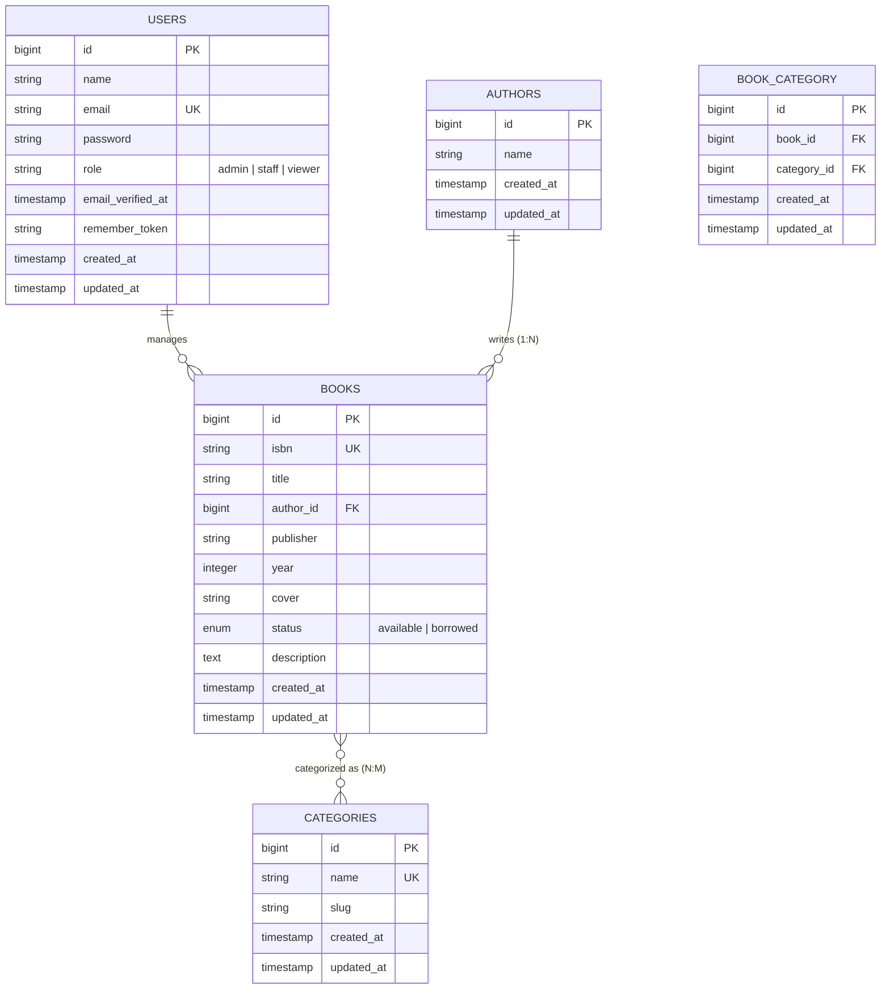
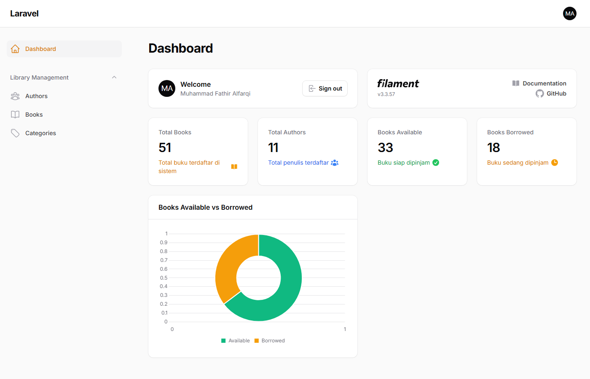
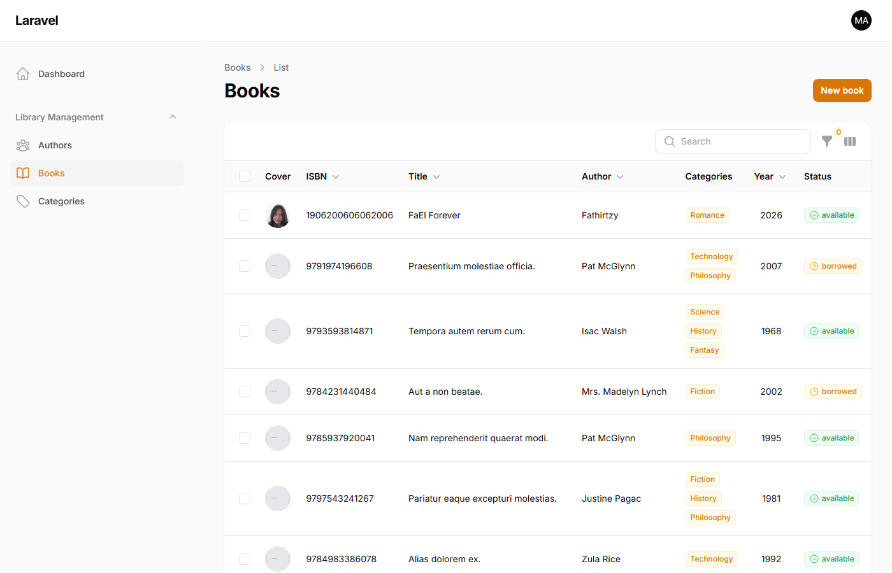
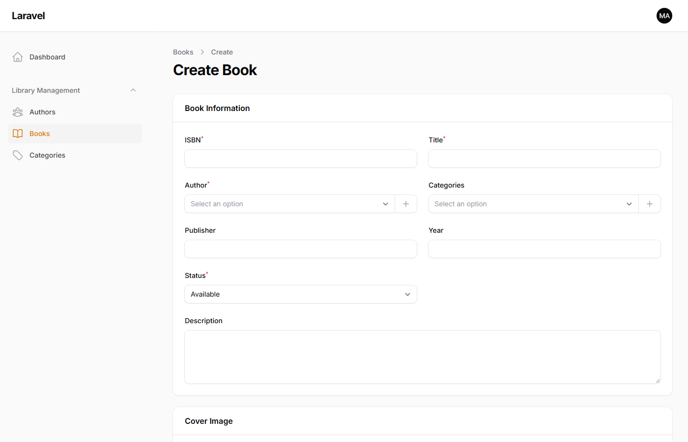
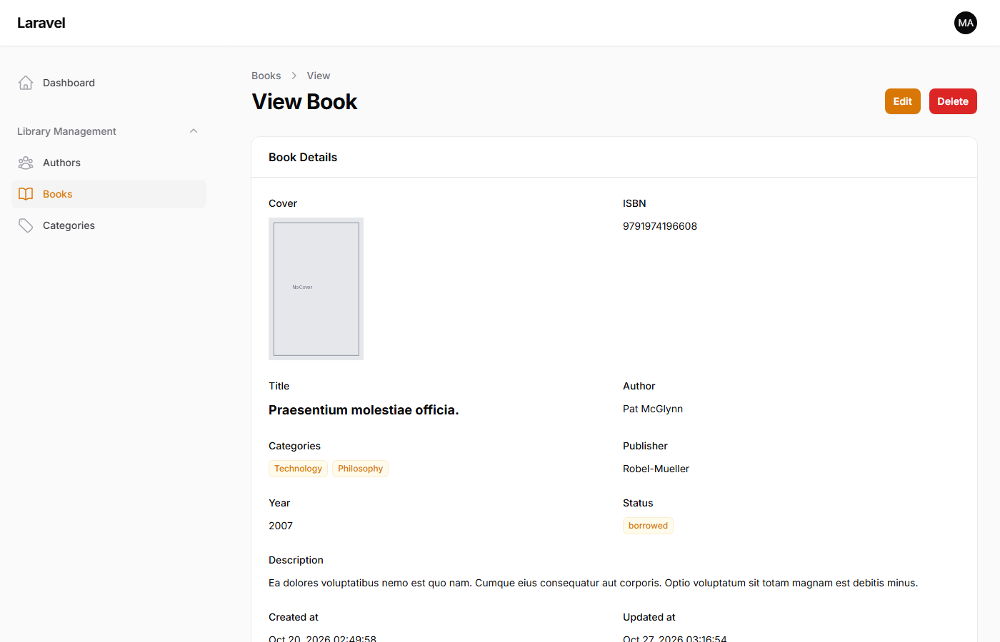
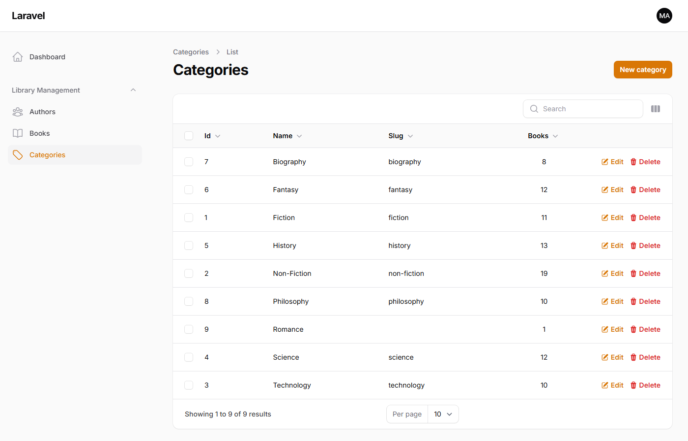

# 📘 Laporan Praktikum Pemrograman Berbasis Web - Pertemuan 7

🧑‍🎓 **Muhammad Fathir Alfarqi** — `4524210064`  
🏛️ **Program Studi**: Teknik Informatika  
📌 **Topik Praktikum**: Kustomisasi & Pengembangan Lanjutan Sistem Manajemen Buku (*AuthBook*) — Filament 3.x & Laravel 12  
📅 **Mata Kuliah**: Pemrograman Berbasis Web (Kelas A)  

---

# 📚 AuthBook v2.0 — Extended Book Management System

**AuthBook v2.0** merupakan evolusi lanjutan dari sistem manajemen buku berbasis **Laravel 12** dan **Filament 3.x**. Pada pertemuan ke-7 ini, fokus utama adalah pengerjaan **Tugas 2: Kustomisasi dan Pengembangan (Bobot Nilai: 40 Poin)**. Pengembangan ini mengintegrasikan pengayaan atribut entitas buku (*description field*), penerapan sistem otorisasi multi-peran (*Role-Based Access Control / RBAC*), visualisasi metrik data melalui *Dashboard Widgets* (kartu ringkasan statistik dan *interactive doughnut chart*), serta relasi banyak-ke-banyak (*many-to-many relationship*) untuk pengelolaan kategori buku (*Category Management*).

<p align="center">
  
  
  
  
  
  
</p>

---

## ⚡ Panduan Cepat Menjalankan Aplikasi (*Quick Start*)

Ikuti langkah-langkah di bawah ini untuk menjalankan aplikasi pada *environment* lokal:

```bash
# 1. Beralih ke direktori proyek authbook
cd "Pertemuan 7/authbook"

# 2. Instalasi dependensi Composer dan NPM (jika belum)
composer install
npm install

# 3. Pengaturan environment aplikasi (.env)
cp .env.example .env
php artisan key:generate

# 4. Jalankan migrasi skema basis data dan pengisian data uji (seeding)
touch database/database.sqlite
php artisan migrate:fresh --seed

# 5. Konfigurasi symbolic link berkas penyimpanan publik dan publish aset Filament
php artisan storage:link
php artisan filament:assets

# 6. Jalankan server lokal Laravel
php artisan serve
```

Akses portal admin Filament melalui peramban:  
🌐 **`http://127.0.0.1:8000/admin`**

### 🔑 Kredensial Pengujian Hak Akses (*Role-Based Access Control*):
| Peran (*Role*) | Alamat Email | Kata Sandi | Deskripsi Hak Akses |
| :--- | :--- | :--- | :--- |
| **Admin** | `admin@example.com` | `password` | **Full Access**: Melihat, membuat, memperbarui, dan menghapus seluruh record. |
| **Staff** | `staff@example.com` | `password` | **Editor Access**: Melihat, membuat, dan memperbarui buku (tombol *delete* disembunyikan/dilarang). |
| **Viewer** | `viewer@example.com` | `password` | **Read-Only**: Hanya dapat melihat ringkasan dashboard dan detail record (*view*). |
| **Akun Pribadi** | `muhammadfathir1906@gmail.com` | `password` | Akun Administrator atas nama **Muhammad Fathir Alfarqi**. |

---

## 📑 Daftar Isi Laporan

- [Ringkasan Capaian Pengembangan](#-ringkasan-capaian-pengembangan)
- [Struktur Relasi & Skema Basis Data](#-struktur-relasi--skema-basis-data)
- [Dokumentasi Rinci Implementasi Tugas 2](#-dokumentasi-rinci-implementasi-tugas-2)
  - [Modul 1: Penambahan Field Description pada Entitas Buku](#modul-1-penambahan-field-description-pada-entitas-buku)
  - [Modul 2: Implementasi Role-Based Access Control (RBAC)](#modul-2-implementasi-role-based-access-control-rbac)
  - [Modul 3: Visualisasi Dashboard Widgets (Stats & Chart)](#modul-3-visualisasi-dashboard-widgets-stats--chart)
  - [Modul 4: Pengelolaan Kategori Buku (Many-to-Many Relationship)](#modul-4-pengelolaan-kategori-buku-many-to-many-relationship)
- [Bukti Verifikasi & Hasil Pengujian Antarmuka](#-bukti-verifikasi--hasil-pengujian-antarmuka)
- [Kesimpulan Praktikum](#-kesimpulan-praktikum)

---

## 📌 Ringkasan Capaian Pengembangan

Pada praktikum Pertemuan 7 ini, sistem AuthBook diperluas dari versi dasar (Pertemuan 6) menjadi sistem manajemen katalog buku yang lebih kaya fitur:

1. **Atribut Deskripsi Buku**: Penambahan kolom naratif deskripsi buku yang terintegrasi pada skema migrasi, model Eloquent, generator dummy (*factory*), form input *textarea*, serta panel tampilan detail (*infolist*).
2. **Keamanan Berbasis Peran (*RBAC*)**: Pemisahan otorisasi pengguna ke dalam tiga tingkatan peran (*Admin*, *Staff*, dan *Viewer*) yang ditegakkan melalui Laravel Policy (`BookPolicy`) dan kontrak `FilamentUser`.
3. **Dashboard Analitik**: Pemasangan widget ringkasan statistik (total buku, total penulis, ketersediaan buku) serta grafik donat (*doughnut chart*) interaktif untuk memonitor rasio buku yang tersedia vs dipinjam secara langsung tanpa delay.
4. **Relasi Kategori *Many-to-Many***: Pembentukan tabel kategori dan tabel pivot `book_category`, didukung pemilihan kategori majemuk (*multiple select*) dengan pencarian cepat (*searchable*), *preload*, dan *inline modal creation*.

---

## 🗄️ Struktur Relasi & Skema Basis Data

Sistem basis data menggunakan relasi referensial antar tabel yang terstruktur sebagai berikut:



---

## 🛠️ Dokumentasi Rinci Implementasi Tugas 2

### Modul 1: Penambahan Field Description pada Entitas Buku

Tujuan modul ini adalah menyediakan ruang deskripsi sinopsis atau ringkasan buku pada katalog.

#### 1. Berkas Migrasi Skema Basis Data
Dibuat migrasi baru `database/migrations/2026_10_27_000001_add_description_to_books_table.php`:

```php
use Illuminate\Database\Migrations\Migration;
use Illuminate\Database\Schema\Blueprint;
use Illuminate\Support\Facades\Schema;

return new class extends Migration
{
    public function up(): void
    {
        Schema::table('books', function (Blueprint $table) {
            $table->text('description')->nullable()->after('year');
        });
    }

    public function down(): void
    {
        Schema::table('books', function (Blueprint $table) {
            $table->dropColumn('description');
        });
    }
};
```

#### 2. Konfigurasi Mass Assignment pada Model Eloquent
Atribut `description` didaftarkan ke dalam array `$fillable` pada berkas `app/Models/Book.php`:

```php
protected $fillable = [
    'isbn',
    'title',
    'author_id',
    'publisher',
    'year',
    'cover',
    'status',
    'description', // Field baru
];
```

#### 3. Penambahan Komponen Form & Infolist Filament
Pada `app/Filament/Resources/BookResource.php`, komponen `Textarea` ditambahkan dengan lebar penuh (`columnSpanFull`):

```php
Forms\Components\Textarea::make('description')
    ->label('Description')
    ->rows(4)
    ->columnSpanFull(),
```

Dan pada `app/Filament/Resources/BookResource/Pages/ViewBook.php` ditambahkan komponen entri teks untuk menampilkan deskripsi buku saat record ditinjau:

```php
Infolists\Components\TextEntry::make('description')
    ->label('Description')
    ->columnSpanFull(),
```

#### 4. Generator Dummy (*Factory*)
Pada `database/factories/BookFactory.php`, deskripsi diisi menggunakan generator paragraf palsu:

```php
public function definition(): array
{
    return [
        'isbn' => fake()->unique()->isbn13(),
        'title' => fake()->sentence(3),
        'author_id' => Author::factory(),
        'publisher' => fake()->company(),
        'year' => fake()->numberBetween(1950, 2024),
        'status' => fake()->randomElement(['available', 'borrowed']),
        'description' => fake()->paragraph(), // Generate paragraf dummy
    ];
}
```

---

### Modul 2: Implementasi Role-Based Access Control (RBAC)

Modul ini membatasi hak istimewa pengguna sesuai tanggung jawab operasional masing-masing peran.

#### 1. Migrasi Kolom Role pada Tabel Pengguna
Dibuat berkas `database/migrations/2026_10_27_000002_add_role_to_users_table.php`:

```php
Schema::table('users', function (Blueprint $table) {
    $table->string('role')->default('viewer')->after('email');
});
```

#### 2. Pembaruan Model User & Kontrak Panel Filament
Model `app/Models/User.php` mengimplementasikan antarmuka `FilamentUser` dan menambahkan fungsi otorisasi akses panel serta method helper:

```php
namespace App\Models;

use Filament\Models\Contracts\FilamentUser;
use Filament\Panel;
use Illuminate\Foundation\Auth\User as Authenticatable;

class User extends Authenticatable implements FilamentUser
{
    protected $fillable = [
        'name',
        'email',
        'password',
        'role',
    ];

    public function canAccessPanel(Panel $panel): bool
    {
        return empty($this->role) || in_array($this->role, ['admin', 'staff', 'viewer']);
    }

    public function isAdmin(): bool
    {
        return $this->role === 'admin';
    }

    public function isStaff(): bool
    {
        return $this->role === 'staff';
    }

    public function isViewer(): bool
    {
        return $this->role === 'viewer';
    }
}
```

#### 3. Logika Otorisasi Kebijakan (*BookPolicy*)
Aturan izin akses CRUD didefinisikan secara ketat pada `app/Policies/BookPolicy.php`:

```php
namespace App\Policies;

use App\Models\Book;
use App\Models\User;

class BookPolicy
{
    // Admin, Staff, dan Viewer dapat melihat daftar buku
    public function viewAny(User $user): bool
    {
        return in_array($user->role, ['admin', 'staff', 'viewer']);
    }

    // Admin, Staff, dan Viewer dapat melihat detail buku
    public function view(User $user, Book $book): bool
    {
        return in_array($user->role, ['admin', 'staff', 'viewer']);
    }

    // Hanya Admin dan Staff yang dapat menambah buku baru
    public function create(User $user): bool
    {
        return in_array($user->role, ['admin', 'staff']);
    }

    // Hanya Admin dan Staff yang dapat memperbarui data buku
    public function update(User $user, Book $book): bool
    {
        return in_array($user->role, ['admin', 'staff']);
    }

    // Hanya Admin yang berhak menghapus record buku
    public function delete(User $user, Book $book): bool
    {
        return $user->role === 'admin';
    }

    // Hanya Admin yang berhak melakukan penghapusan massal
    public function deleteAny(User $user): bool
    {
        return $user->role === 'admin';
    }
}
```

---

### Modul 3: Visualisasi Dashboard Widgets (Stats & Chart)

Modul ini menambahkan ringkasan data kunci pada landing page admin panel untuk mempermudah pemantauan koleksi perpustakaan.

#### 1. Widget Statistik Ringkasan (*Stats Overview*)
Berkas `app/Filament/Widgets/BookStatsOverviewWidget.php` menyajikan 4 kartu metrik utama:

```php
namespace App\Filament\Widgets;

use App\Models\Author;
use App\Models\Book;
use Filament\Widgets\StatsOverviewWidget as BaseWidget;
use Filament\Widgets\StatsOverviewWidget\Stat;

class BookStatsOverviewWidget extends BaseWidget
{
    protected static bool $isLazy = false;
    protected static ?int $sort = 1;

    protected function getStats(): array
    {
        $totalBooks = Book::count();
        $totalAuthors = Author::count();
        $availableBooks = Book::where('status', 'available')->count();
        $borrowedBooks = Book::where('status', 'borrowed')->count();

        return [
            Stat::make('Total Books', $totalBooks)
                ->description('Total buku terdaftar di sistem')
                ->descriptionIcon('heroicon-m-book-open')
                ->color('primary'),

            Stat::make('Total Authors', $totalAuthors)
                ->description('Total penulis terdaftar')
                ->descriptionIcon('heroicon-m-user-group')
                ->color('info'),

            Stat::make('Books Available', $availableBooks)
                ->description('Buku siap dipinjam')
                ->descriptionIcon('heroicon-m-check-circle')
                ->color('success'),

            Stat::make('Books Borrowed', $borrowedBooks)
                ->description('Buku sedang dipinjam')
                ->descriptionIcon('heroicon-m-clock')
                ->color('warning'),
        ];
    }
}
```

#### 2. Widget Grafik Status Ketersediaan (*Chart Widget*)
Berkas `app/Filament/Widgets/BookStatusChartWidget.php` menyajikan visualisasi proporsi ketersediaan buku dalam format *doughnut chart*:

```php
namespace App\Filament\Widgets;

use App\Models\Book;
use Filament\Widgets\ChartWidget;

class BookStatusChartWidget extends ChartWidget
{
    protected static bool $isLazy = false;
    protected static ?string $heading = 'Books Available vs Borrowed';
    protected static ?int $sort = 2;
    protected static ?string $maxHeight = '280px';

    protected function getData(): array
    {
        $available = Book::where('status', 'available')->count();
        $borrowed = Book::where('status', 'borrowed')->count();

        return [
            'datasets' => [
                [
                    'label' => 'Total Books',
                    'data' => [$available, $borrowed],
                    'backgroundColor' => [
                        '#10B981', // Hijau untuk ketersediaan
                        '#F59E0B', // Oranye/Amber untuk pinjaman
                    ],
                ],
            ],
            'labels' => ['Available', 'Borrowed'],
        ];
    }

    protected function getType(): string
    {
        return 'doughnut';
    }
}
```

---

### Modul 4: Pengelolaan Kategori Buku (Many-to-Many Relationship)

Modul ini memungkinkan pengelompokan buku ke dalam beberapa genre/kategori secara bersamaan.

#### 1. Migrasi Tabel Kategori & Tabel Pivot
Dibuat dua berkas migrasi:
* `database/migrations/2026_10_27_000003_create_categories_table.php`:
  ```php
  Schema::create('categories', function (Blueprint $table) {
      $table->id();
      $table->string('name')->unique();
      $table->string('slug')->nullable();
      $table->timestamps();
  });
  ```
* `database/migrations/2026_10_27_000004_create_book_category_table.php`:
  ```php
  Schema::create('book_category', function (Blueprint $table) {
      $table->id();
      $table->foreignId('book_id')->constrained()->cascadeOnDelete();
      $table->foreignId('category_id')->constrained()->cascadeOnDelete();
      $table->timestamps();
      $table->unique(['book_id', 'category_id']);
  });
  ```

#### 2. Definisi Relasi pada Model Eloquent
* Pada `app/Models/Category.php`:
  ```php
  public function books(): BelongsToMany
  {
      return $this->belongsToMany(Book::class);
  }
  ```
* Pada `app/Models/Book.php`:
  ```php
  public function categories(): BelongsToMany
  {
      return $this->belongsToMany(Category::class);
  }
  ```

#### 3. Integrasi Form Multiple Select & Resource
Pada `app/Filament/Resources/BookResource.php`, form buku dilengkapi pemilih relasi ganda dengan kemampuan penambahan kategori instan:

```php
Forms\Components\Select::make('categories')
    ->label('Categories')
    ->relationship('categories', 'name')
    ->multiple()
    ->searchable()
    ->preload()
    ->createOptionForm([
        Forms\Components\TextInput::make('name')
            ->required()
            ->maxLength(255),
    ]),
```

Tabel daftar buku juga dilengkapi kolom badge kategori:
```php
Tables\Columns\TextColumn::make('categories.name')
    ->label('Categories')
    ->badge()
    ->separator(',')
    ->searchable(),
```

Serta dibuatkan resource mandiri `CategoryResource.php` untuk pengelolaan entitas kategori secara langsung dari menu bilah sisi (*sidebar*).

---

## 📷 Bukti Verifikasi & Hasil Pengujian Antarmuka

Berikut adalah dokumentasi hasil uji fungsionalitas dan tangkapan layar fitur-fitur Tugas 2 yang berhasil berjalan dengan sempurna:

### 1. Dashboard Admin & Widgets Analitik
Menampilkan kartu metrik (Total Books, Total Authors, Books Available, Books Borrowed) serta visualisasi Doughnut Chart (*Available vs Borrowed*) dengan identitas akun **Muhammad Fathir Alfarqi**:



---

### 2. Daftar Katalog Buku dengan Badge Kategori
Menampilkan tabel daftar buku yang memuat badge multi-kategori, indikator ketersediaan status, ISBN, penulis, dan tindakan operasional:



---

### 3. Formulir Penambahan Buku (*Create Book Form*)
Menampilkan input *Multiple Select Categories* dengan pencarian cepat serta komponen *Textarea Description* untuk sinopsis buku:



---

### 4. Tampilan Detail Informasi Buku (*Infolist View*)
Menampilkan pratinjau data buku terperinci (*read-only*) termasuk badge kategori dan teks paragraf deskripsi hasil seeder:



---

### 5. Manajemen Kategori (*Category Resource*)
Menampilkan modul manajemen data kategori lengkap dengan kalkulasi jumlah buku terkait (*books count*) dan opsi penambahan kategori baru:



---

### 6. Pengujian Otorisasi Hak Akses Peran Staff (*Staff Role*)
Login sebagai akun Staff (`staff@example.com`). Pengguna memiliki izin menambah (*New book*) dan mengubah (*Edit*), namun **tombol hapus (Delete Action) disembunyikan dan dilarang** oleh sistem:


---

### 7. Pengujian Otorisasi Hak Akses Peran Viewer (*Viewer Role*)
Login sebagai akun Viewer (`viewer@example.com`). Pengguna hanya berstatus *Read-Only* di mana seluruh tombol manipulasi data (*New book*, *Edit*, *Delete*) **dihilangkan dari antarmuka**:


---

## 🎓 Kesimpulan Praktikum

Pengerjaan praktikum Pertemuan 7 (Tugas 2) ini membuktikan kekuatan ekosistem **Laravel 12** dan **Filament 3.x** dalam membangun sistem aplikasi *back-office* kelas profesional:
1. **Fleksibilitas Arsitektur Eloquent**: Penanganan skema relasi kompleks (*Many-to-Many*) dapat diselesaikan dengan bersih menggunakan tabel pivot dan method relasi ringkas.
2. **Kekuatan Deklaratif Filament**: Integrasi komponen form lanjutan seperti *Multiple Select* dengan modal inline, filter tabel dinamis, serta widget analitik dapat diimplementasikan dalam waktu singkat tanpa boilerplate JavaScript manual.
3. **Pemberlakuan Keamanan Ketat**: Penerapan *Role-Based Access Control* melalui Laravel Policy menjamin integritas data katalog perpustakaan sesuai batasan peran administratif masing-masing pengguna.
