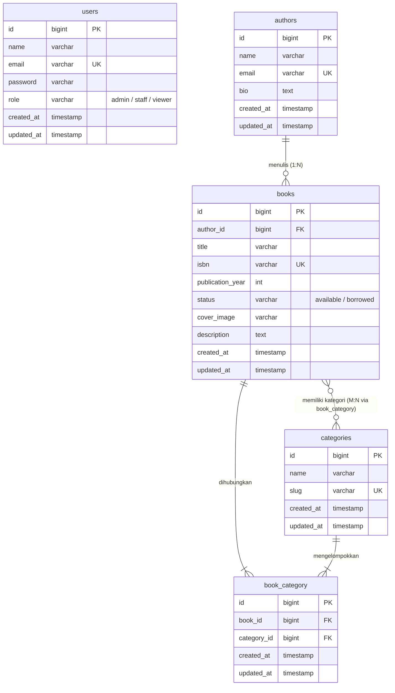
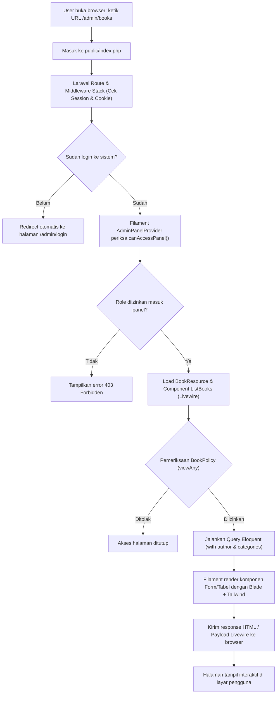

# Laporan Praktikum Pemrograman Berbasis Web
## Pertemuan 8: Tugas 3 - Analisis dan Dokumentasi Sistem AuthBook

**Identitas Mahasiswa:**
* **Nama:** Muhammad Fathir Alfarqi
* **NIM:** 4524210064
* **Kelas:** PBW A
* **Proyek:** Aplikasi Manajemen Buku (AuthBook - Laravel 12 & Filament 3.x)

---

## 1. Penjelasan Arsitektur Sistem

Aplikasi AuthBook yang kami kembangkan ini menggunakan Laravel 12 sebagai backend framework dan Filament 3.x sebagai admin panel builder. Filament sendiri berjalan di atas TALL Stack (Tailwind CSS, Alpine.js, Laravel, Livewire), sehingga semua logika form, tabel, filter, dan modal dieksekusi secara reaktif tanpa kita harus menulis file JavaScript atau API endpoint manual.

### 1.1 Diagram ERD (Entity Relationship Diagram)

Berikut adalah diagram relasi tabel pada database sistem AuthBook:

### 1.2 Penjelasan Relasi Antar Tabel

1. **Tabel `authors` ke `books` (One to Many / 1:N)**
   * Satu penulis (*author*) bisa memiliki banyak buku, tetapi satu buku hanya terdaftar atas nama satu penulis utama.
   * Relasi ini dihubungkan oleh kolom `author_id` di tabel `books` yang mereferensikan `id` pada tabel `authors`.
   * Pada level model Laravel:
     * Model `Author`: `public function books() { return $this->hasMany(Book::class); }`
     * Model `Book`: `public function author() { return $this->belongsTo(Author::class); }`
   * Pada database diberi *cascade on delete*, jadi jika seorang author dihapus, seluruh data bukunya ikut terhapus agar tidak terjadi data yatim (*orphan data*).

2. **Tabel `books` ke `categories` (Many to Many / M:N)**
   * Satu buku bisa masuk ke dalam beberapa kategori sekaligus (misalnya buku Laravel masuk kategori *Teknologi* dan *Pemrograman*). Sebaliknya, satu kategori bisa memuat puluhan judul buku.
   * Karena sifatnya *many-to-many*, dibuat tabel perantara bernama `book_category` yang menyimpan pasangan `book_id` dan `category_id`.
   * Pada level model Laravel:
     * Model `Book`: `public function categories() { return $this->belongsToMany(Category::class); }`
     * Model `Category`: `public function books() { return $this->belongsToMany(Book::class); }`
   * Pada form Filament, relasi ini di-handle otomatis dengan komponen `Select::make('categories')->relationship('categories', 'name')->multiple()`.

3. **Tabel `users` dan Implementasi Role-Based Access Control (RBAC)**
   * Tabel `users` menyimpan akun login pengguna dan memiliki kolom `role` dengan 3 opsi nilai: `admin`, `staff`, dan `viewer`.
   * Model `User` mengimplementasikan `FilamentUser` dengan method `canAccessPanel()` agar hanya user terdaftar yang bisa masuk ke `/admin`.
   * Relasi wewenang ini diatur lewat `BookPolicy`. Jadi tidak ada tabel foreign key langsung ke `books`, melainkan hak akses CRUD dicek di policy sebelum user bisa melihat tombol atau melakukan aksi create/edit/delete buku.

---

### 1.3 Alur Kerja Aplikasi (Flow dari Request hingga Response)

**Tahapan Alur Kerja Secara Rinci:**
1. **Request Datang**: Pengguna mengakses alamat `/admin/books` melalui peramban. Request pertama kali ditangkap oleh file `public/index.php`.
2. **Middleware & Sesi**: Laravel mengecek apakah sesi aktif ada. Jika belum login, rute langsung melempar redirect ke `/admin/login`.
3. **Validasi Panel**: Filament mengecek method `canAccessPanel()` pada model `User`. Jika bernilai `true`, akses ke dashboard dibuka.
4. **Pengecekan Policy (Otorisasi)**: Sebelum merender data buku, Filament menjalankan `BookPolicy::viewAny()`. Di sini peran user (`admin`, `staff`, atau `viewer`) langsung menentukan elemen apa saja yang boleh muncul di layar.
5. **Eksekusi Query Database**: Laravel menjalankan query Eloquent secara otomatis dengan *eager loading* relasi author dan kategori agar loading data tetap cepat dan tidak terjadi *N+1 query problem*.
6. **Rendering Tampilan**: Filament merender komponen Blade yang sudah dibundel dengan class Tailwind CSS dan skrip Alpine.js/Livewire.
7. **Response & Interaksi**: Browser menampilkan tabel buku lengkap dengan tombol aksi, pencarian, dan badge kategori. Saat user melakukan filter atau search, Livewire mengirim request AJAX kecil di latar belakang tanpa me-refresh seluruh halaman web.

---

## 2. Perbandingan: Filament vs CRUD Manual Tradisional

### 2.1 Tabel Komparasi Pengerjaan CRUD

| Aspek Perbandingan | Cara Tradisional (Manual MVC Laravel) | Cara Modern (Filament 3.x) |
| :--- | :--- | :--- |
| **Banyaknya File yang Dibuat** | Sangat banyak (minimal 8 file: 1 Controller, 1 Model, 1 Migration, 1 FormRequest, 1 Route web, dan 4-5 file Blade view). | Sangat ringkas (cukup 1 Model, 1 Migration, dan 1 file Resource Filament). |
| **Waktu Pengerjaan** | Butuh waktu 2 sampai 4 jam per tabel data untuk styling form, merapikan tabel HTML, dan testing validasi. | Cukup 15 - 30 menit saja, form dan tabel langsung jadi secara otomatis. |
| **Pencarian dan Filter** | Harus menulis logika `where('title', 'like', ...)` manual di controller dan membuat form input pencarian di Blade. | Cukup tambahkan `->searchable()` dan `->sortable()` pada kolom tabel di Resource. |
| **Pagination Data** | Harus memanggil `->paginate()` di controller dan memanggil `{{ $data->links() }}` di Blade view. | Otomatis tersedia di bagian bawah tabel tanpa konfigurasi tambahan. |
| **Desain dan Responsivitas UI** | Harus mendesain sendiri pakai CSS atau Bootstrap/Tailwind. Rentan beda gaya jika dikerjakan bersama teman. | Sangat konsisten, rapi, modern, dan otomatis responsif di HP maupun desktop. |
| **Integrasi Hak Akses (RBAC)** | Harus pasang directive `@can` satu per satu di tombol view Blade dan `$this->authorize` di controller. | Otomatis membaca Laravel Policy; tombol Edit/Delete otomatis disembunyikan sesuai role. |

### 2.2 Kelebihan dan Kekurangan Masing-Masing

#### A. Filament 3.x
* **Kelebihan:**
  1. *Kecepatan Pembuatan*: Fitur backoffice bisa selesai jauh lebih cepat dibanding membuat view Blade satu per satu.
  2. *Fitur Bawaan Sangat Lengkap*: Sudah ada fitur modal popup, pencarian global, filter tanggal/relasi, bulk delete, sampai export data.
  3. *Tampilan Rapi & Modern*: Menggunakan Tailwind CSS bawaan yang bersih dan mendukung dark mode secara native.
  4. *Otorisasi Terpusat*: Cukup atur method di Policy class, semua tombol di antarmuka langsung patuh pada aturan hak akses.
* **Kekurangan:**
  1. *Ketergantungan Livewire*: Jika ada error Javascript atau Livewire macet, tampilan form bisa tidak merespons sama sekali.
  2. *Kurang Cocok untuk Desain Kustom Bebas*: Jika dosen atau klien meminta layout form yang sangat unik di luar standar panel admin, modifikasinya cukup rumit.

#### B. Pendekatan Tradisional (Manual Blade MVC)
* **Kelebihan:**
  1. *Bebas 100% Mengatur Tampilan*: Kita bebas menaruh tag HTML, CSS animasi, atau library JS apa saja tanpa aturan framework admin.
  2. *Alur Logika Sangat Jelas*: Lebih mudah dipahami oleh pemula karena alurnya langsung dari route $\rightarrow$ controller $\rightarrow$ view tanpa layer abstraksi.
  3. *Ringan*: Tidak ada overhead bundle library admin, sehingga cocok untuk server yang kapasitas RAM-nya terbatas.
* **Kekurangan:**
  1. *Banyak Kode Berulang (Boilerplate)*: Sering copy-paste kode form, tabel, pagination, dan pesan flash notifikasi untuk setiap entitas baru.
  2. *Beban Maintenance Tinggi*: Jika kolom di database ditambah, kita harus mengubah berkas migration, model, controller, request, dan view Blade sekaligus.

### 2.3 Kapan Sebaiknya Menggunakan Filament dan Kapan Tidak?

* **Gunakan Filament Ketika:**
  * Membuat aplikasi internal kantor, sistem informasi manajemen (SIM), dashboard admin, inventaris barang, atau perpustakaan sekolah.
  * Waktu pengerjaan proyek mepet (*tight deadline*) dan butuh aplikasi yang langsung siap pakai dengan keamanan standar.
  * Aplikasi membutuhkan banyak tabel data yang butuh fitur sort, filter, dan laporan statistik data.

* **Sebaiknya TIDAK Menggunakan Filament (Pilih Manual / Frontend Terpisah) Ketika:**
  * Membuat halaman landing page publik, blog untuk pembaca umum, atau toko online (*e-commerce*) bagian konsumen yang membutuhkan tampilan visual estetik dan branding khusus.
  * Aplikasi yang arsitekturnya *headless* atau berbasis mobile app (Flutter/React Native), di mana Laravel hanya difungsikan sebagai RESTful API.
  * Aplikasi yang membutuhkan interaktivitas grafis khusus, seperti canvas drawing atau game berbasis web.

---

## 3. Refleksi Pembelajaran

### 3.1 Hal-Hal Baru yang Dipelajari

Dari modul praktikum Pertemuan 7 dan 8 ini, beberapa poin penting yang berhasil saya pahami antara lain:
1. Cara kerja ekosistem Filament 3 di Laravel 12 dan bagaimana paradigma deklaratif menggunakan method chaining PHP (`Forms\Components` dan `Tables\Columns`) dapat menggantikan pembuatan file Blade manual.
2. Pembuatan relasi Many-to-Many pada database menggunakan tabel pivot `book_category`, serta cara menampilkannya di form dengan komponen multi-select yang bisa langsung menambah opsi kategori baru (*inline creation*).
3. Penerapan sistem hak akses berjenjang (Admin, Staff, Viewer) menggunakan Laravel Policy bawaan yang langsung terintegrasi mulus ke tampilan tombol Filament.
4. Pembuatan visualisasi data statistik (*Widgets*) seperti ringkasan total buku dan chart donat status ketersediaan buku di dashboard utama.

### 3.2 Kendala Teknis yang Dihadapi dan Solusinya

Selama proses pengerjaan, ada beberapa kendala yang sempat saya temui:
1. **Error `405 MethodNotAllowedHttpException` saat Login Admin**:
   * *Masalah*: Awalnya saat form login disubmit, muncul error 405 karena PHP built-in server (`php -S`) belum memakai skrip perutean `server.php` dan aset Javascript Filament belum terpublikasi di folder public.
   * *Solusi*: Saya jalankan server dengan perintah `php -S 127.0.0.1:8000 -t public server.php` dan mengeksekusi `php artisan filament:assets` agar semua file JS dan CSS Filament terbaca dengan benar.
2. **Error Database Terkunci (*Database Locked*) di SQLite**:
   * *Masalah*: Saat membuka dashboard yang memuat beberapa widget sekaligus, muncul pesan database lock karena sesi disimpan di database SQLite (`SESSION_DRIVER=database`).
   * *Solusi*: Saya ubah pengaturan di file `.env` menjadi `SESSION_DRIVER=file` dan `CACHE_STORE=file` agar pembacaan sesi tidak membebani file SQLite.
3. **Konfigurasi Relasi Multi-Select Kategori Buku**:
   * *Masalah*: Awalnya data kategori yang dipilih di form tidak tersimpan otomatis ke tabel pivot `book_category`.
   * *Solusi*: Ternyata komponen select harus menggunakan fungsi `->relationship('categories', 'name')` lengkap dengan properti `->multiple()`, sehingga Eloquent secara otomatis melakukan fungsi sync ke tabel pivot saat buku disimpan.

### 3.3 Rencana Pengembangan Aplikasi ke Depan

Jika aplikasi AuthBook ini ingin dikembangkan lebih lanjut menjadi aplikasi perpustakaan kampus yang siap digunakan secara nyata, rencana saya ke depan adalah:
1. **Menambahkan Modul Sirkulasi Peminjaman**: Membuat tabel `loans` untuk mencatat mahasiswa yang meminjam buku, tanggal pinjam, batas tanggal pengembalian, serta status denda jika terlambat.
2. **Fitur Pengingat via Email**: Menjadwalkan pengiriman email otomatis kepada peminjam h-2 sebelum batas waktu peminjaman buku habis menggunakan Laravel Mail dan Task Scheduling.
3. **Fitur Ekspor Laporan Excel/PDF**: Menambahkan tombol export pada tabel buku dan riwayat peminjaman dengan plugin `pxlrbt/filament-excel` agar memudahkan petugas perpustakaan mencetak rekap data bulanan.
4. **Halaman Katalog untuk Mahasiswa (OPAC)**: Membuat satu halaman katalog buku publik yang sederhana dan ringan tanpa perlu login, sehingga mahasiswa bisa mengecek ketersediaan buku langsung dari smartphone mereka.

---
*Laporan ini disusun oleh Muhammad Fathir Alfarqi sebagai dokumentasi resmi pengerjaan Tugas 3 Praktikum PBW.*
